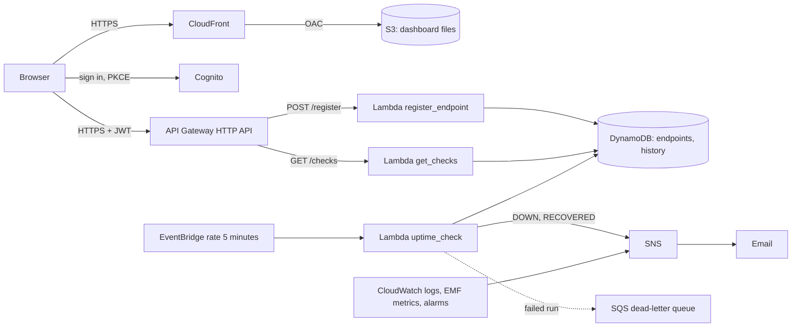

# VigilWatch

[](https://github.com/lesego-rabotapi/VigilWatch/actions/workflows/ci.yml)
[](https://github.com/lesego-rabotapi/VigilWatch/actions/workflows/deploy-dev.yml)

Serverless uptime monitoring built to run inside the AWS free tier: most services stay free indefinitely, and the two
exceptions (API Gateway and S3) are free for the first 12 months and then cost cents, bounded by throttling.

**Status:** everything is built and tested offline; it has not been deployed to an AWS account yet. Claims in
the documentation carry an evidence tag: `CI` (a pipeline job proves it), `MOCK` (a test against simulated
AWS), `REPO` (a document or file), `NEEDS-AWS` (cannot be proven until deployed).

## The "Why" Before the "How"

Teams often find out about outages from their users. Commercial monitoring is
either expensive or heavy to operate for a small team. VigilWatch asks a narrow
question: how much real monitoring (scheduled checks, history, incidents,
alerts and a live dashboard) can you get from managed AWS services while
paying nothing and running no servers?

It is an exercise in engineering trade-offs, Infrastructure as Code and
production habits (tests at every layer, least privilege, gated deploys),
not a tour of AWS services.

## What it does

- Checks every registered URL every 5 minutes (HTTP GET, 5 s timeout, no redirects followed).
- Classifies each check as `UP`, `DEGRADED` (correct status but slower than 1 s) or `DOWN`.
- Tells a failed check from a failed checker: if nothing can be reached, results are `INCONCLUSIVE` and no false alert goes out.
- Keeps 48 h of raw checks and 30 days of daily rollups and incidents.
- Opens an incident and emails once after 2 consecutive `DOWN` checks, and emails again on recovery.
- Requires sign-in (Cognito); each user sees and manages only their own endpoints.
- Serves a dashboard with current status, 30-day uptime, a latency trend and incident history.
- Alarms on the monitor itself: checker errors, checker not running, checker blind, dead-lettered runs, API 5xx.

## Try it without AWS

```bash
pip install -r requirements-dev.txt
python scripts/local_api.py      # dashboard and API on http://127.0.0.1:8787, AWS mocked, probes are real
```

## Architecture



More detail: [docs/README.md](docs/README.md). Operations: [docs/RUNBOOK.md](docs/RUNBOOK.md). Recovery and
service levels: [docs/resilience.md](docs/resilience.md), [docs/slo.md](docs/slo.md). Security: [docs/security.md](docs/security.md).
Measured performance: [docs/performance.md](docs/performance.md). What a reviewer tends to ask: [docs/interview-notes.md](docs/interview-notes.md).

## Engineering decisions

| Decision | What was chosen | Evidence |
|---|---|---|
| [ADR 0001](docs/adr/0001-http-api-over-rest-api.md) | HTTP API, not REST API | `REPO` |
| [ADR 0002](docs/adr/0002-provisioned-dynamodb-with-rollups.md) | Provisioned DynamoDB with daily rollups | `CI` |
| [ADR 0003](docs/adr/0003-emf-metrics-without-per-endpoint-dimensions.md) | One metric dimension per environment, not per URL | `REPO` |
| [ADR 0004](docs/adr/0004-zero-cost-security-tradeoffs.md) | Security controls that cost nothing, and the risks accepted | `MOCK` `NEEDS-AWS` |
| [ADR 0005](docs/adr/0005-environments-and-modules.md) | Modules, and dev plus prod in one account | `CI` |
| [ADR 0006](docs/adr/0006-checker-honesty.md) | A failed check is not a failed checker | `MOCK` |
| [ADR 0007](docs/adr/0007-authentication.md) | Cognito sign-in with a JWT authorizer | `MOCK` `NEEDS-AWS` |
| [ADR 0008](docs/adr/0008-runtime-patterns.md) | Reused clients and structured logs; what was not adopted | `MOCK` `NEEDS-AWS` |
| [ADR 0009](docs/adr/0009-pipeline-and-promotion.md) | Build once, promote, roll back, detect drift | `CI` `NEEDS-AWS` |
| [ADR 0010](docs/adr/0010-integration-backend.md) | Integration tests against a moto server, not LocalStack | `CI` |

## Why these technologies?

| Technology | Reasoning |
|---|---|
| Lambda (python3.12, arm64) | No servers; arm64 is cheaper per GB-second; stdlib-only code means no dependency packaging |
| DynamoDB (provisioned) | Key-value access patterns; provisioned capacity is covered by the always-free tier, on-demand is not ([ADR 0002](docs/adr/0002-provisioned-dynamodb-with-rollups.md)) |
| API Gateway HTTP API | Cheaper than REST APIs, built-in CORS, JWT authorizer and throttling ([ADR 0001](docs/adr/0001-http-api-over-rest-api.md)) |
| Cognito | Managed sign-in without running an identity service ([ADR 0007](docs/adr/0007-authentication.md)) |
| EventBridge | Managed schedule, no cron host |
| SNS email | Free for the first 1,000 emails a month |
| CloudFront + private S3 | HTTPS, security headers and caching for a static dashboard; 1 TB/month free |
| Terraform (>= 1.10) | Reproducible infrastructure, remote state with native S3 locking, `terraform test` with a mocked provider |

## Engineering trade-offs

- **Sign-in, but no self-service sign-up.** The owner creates users, so the public cannot add URLs. Monitored URLs are
  capped (10 in total, 5 per user), the API is throttled (5 rps), and every URL passes an SSRF guard
  ([ADR 0007](docs/adr/0007-authentication.md), [ADR 0004](docs/adr/0004-zero-cost-security-tradeoffs.md)).
- **Provisioned DynamoDB.** It is free but can throttle under bursts. Daily rollups keep the
  30-day uptime query at no more than 30 items ([ADR 0002](docs/adr/0002-provisioned-dynamodb-with-rollups.md)).
- **Low-cardinality metrics.** One dimension value per environment fixes the number of custom metrics at seven;
  a per-URL dimension would cost at least $27.00 a month at 100 URLs, and $207.00 with every metric carrying it (computed; [ADR 0003](docs/adr/0003-emf-metrics-without-per-endpoint-dimensions.md)).
- **One region, one probe location.** A check from one region cannot tell "site down" from "network path down";
  control URLs catch a blind checker, not a broken route to one site ([ADR 0006](docs/adr/0006-checker-honesty.md)).
- **No point-in-time recovery.** It is billed, so the endpoints table has deletion protection and a logical backup,
  and the recovery point is the last backup ([docs/resilience.md](docs/resilience.md)).
- **No SIT environment.** Dev and prod share one account and one free tier; a third environment would exceed the free alarms
  ([ADR 0005](docs/adr/0005-environments-and-modules.md)).
- **Cold starts** add latency to the first API call after idle time; the checker is not user-facing, and nothing is
  published until it is measured ([docs/performance.md](docs/performance.md)).

## Cost

| Service | Usage at the defaults | Allowance |
|---|---|---|
| Lambda | ~9k checker runs + API calls, 128 MB | 1M requests, 400k GB-s |
| DynamoDB | dev 2 + prod 5 provisioned units per table, 14 of 25 | 25 RCU, 25 WCU, 25 GB |
| CloudWatch | 7 custom metrics (prod only), 7 alarms across both environments, 2 dashboards, logs kept 14 days | 10 metrics, 10 alarms, 3 dashboards, 5 GB logs |
| SNS | email alerts | 1,000 emails |
| SQS | DLQ, normally empty | 1M requests |
| CloudFront | dashboard traffic | 1 TB, 10M requests |
| API Gateway HTTP API | dashboard polling | 1M calls/month for the first 12 months, then $1.00 per million |
| S3 | a few KB of site files + Terraform state | 5 GB for the first 12 months, then cents |
| Cognito | a handful of users | verify the tier and region before the first deploy (`NEEDS-AWS`) |

`python scripts/free_tier_budget.py` adds up both environments and fails CI if they exceed the allowance. The only
lines that can exceed $0 after the first year are API Gateway and S3, and both are bounded by throttling and tiny
storage. Set up a zero-spend AWS Budget as a backstop (see the runbook).

## Repository structure

```text
lambda/            Lambda handlers + common/ (status, SSRF guard, repositories, checker, auth, view)
terraform/         modules/ (data, compute, api, frontend, monitoring, alerts, auth, vigilwatch), envs/dev and envs/prod,
                   bootstrap/ for state + CI role. Each module carries its own terraform test suite
frontend/          Static dashboard (no build step) + node:test/jsdom tests
tests/             unit/, mock/ (moto), contract/ (API schema), step_defs/ + features/ (BDD), e2e/ (post-deploy), policy tests
scripts/           local_api.py (dashboard + API locally, AWS mocked), build_bundle.py (reproducible Lambda zip),
                   free_tier_budget.py, cardinality_cost.py, measure_cold_start.py, backup/restore tools
docs/              Requirements, design, runbook, security, resilience, SLOs, performance, ADRs
.github/workflows  ci.yml (quality gates); deploy-dev.yml (every push to main, or by hand), promote-prod.yml and
                   rollback.yml (by hand, approval), all through deploy-environment.yml (OIDC, plan -> apply)
```

## Running it on AWS

First-time setup (state bucket, CI role, migrating an older deployment) is in
[docs/RUNBOOK.md](docs/RUNBOOK.md). After bootstrap:

```bash
python scripts/build_bundle.py        # one reproducible Lambda zip, printed with its hash
cd terraform/envs/dev                 # or envs/prod
cp backend.hcl.example backend.hcl    # fill in the state bucket name
terraform init -backend-config=backend.hcl
terraform plan -out=tfplan -var-file=../../.build/vigilwatch.tfvars.json -var 'allowed_account_ids=["<your-account-id>"]' -var notification_email=you@example.com
terraform apply tfplan
terraform output dashboard_url
```

Pushing to `main` runs the same thing in GitHub Actions: CI, then a plan, then apply for dev. Production is promoted by
hand, with a reviewer's approval, using the commit and the exact bundle dev released.

## Testing

Every layer has tests, and every feature in this codebase was written test-first (red, then green). The Python
coverage gate is 90%.

| Layer | Tooling | Command |
|---|---|---|
| Unit (status, SSRF guard, probe) | pytest | `pytest -m unit` |
| Mock (DynamoDB, SNS, handlers, IAM) | pytest + moto | `pytest -m mock` |
| API contract (shared JSON Schema) | pytest + jsonschema, node:test | `pytest tests/contract` |
| Integration (handlers over HTTP, real tables, SNS to SQS) | pytest + moto server | `pytest -m integration` |
| Behaviour (Gherkin scenarios) | pytest-bdd | `pytest -m bdd` |
| Infrastructure | `terraform test` with a mocked AWS provider | `for d in terraform/modules/* terraform/envs/*; do (cd $d && terraform init -backend=false && terraform test); done` |
| Frontend (rendering, XSS, sign-in) | node:test + jsdom | `cd frontend && npm ci && npm test` |
| Pipeline and docs policy | pytest | `pytest -m policy` |
| End-to-end smoke | pytest, against a live or local stack | `pytest -m e2e tests/e2e --env=dev` (address from `API_URL_DEV`) |

```bash
python -m venv .venv && . .venv/bin/activate     # Windows: .venv\Scripts\activate
pip install -r requirements-dev.txt
pytest --cov                                       # fails under 90% coverage
ruff check . && ruff format --check .
```

## Lessons learned

- **2026-10-02** A metric dimension per URL looks harmless and is not: every value is a billed metric, so the cost
  grows with other people's input. The checker uses one dimension and the arithmetic is a script
  ([ADR 0003](docs/adr/0003-emf-metrics-without-per-endpoint-dimensions.md)). `REPO`
- **2026-10-25** A monitor that cannot reach the internet reports everything as down. Telling a failed check from a
  failed checker needed a decision table, control probes and an alarm of its own ([ADR 0006](docs/adr/0006-checker-honesty.md)). `MOCK`
- **2026-10-27** Two environments in one account share one free tier, so each passing its own checks proves nothing.
  A script adds both up and CI fails when the total is over ([free_tier_budget.py](scripts/free_tier_budget.py)). `CI`
- **2026-11-01** A transaction conflict is not a full quota. Reporting one as the other would have told users they were out of
  endpoints when two requests had only collided; it is retried, and a persistent conflict is a 503
  ([registration race tests](tests/mock/test_registration_races.py)). `MOCK`
- **2026-11-03** An asynchronous reply can arrive after the user has signed out. Every late reply now checks that the
  session still exists before touching the page ([dashboard tests](frontend/tests/app.test.js)). `CI`
- **2026-11-07** Two reverts in January left a Lambda file that did not even parse, and main stayed red until this was
  found. The pipeline's package job (added 2026-10-27) imports every handler from the built bundle inside the Lambda
  runtime image, so a bundle like that cannot be deployed ([verify_package.py](scripts/verify_package.py)). `CI`
- **2026-11-07** A rollback that needs a value the old release never produced fails after the infrastructure has already
  changed. The apply step now tolerates the missing value, and a test pins it ([workflow tests](tests/test_workflows.py)). `CI`

## Future improvements

- Multi-region probes to separate "site down" from "path down"
- Custom domain with ACM
- Status-page sharing and Slack/webhook alert channels
- A canary deploy with automatic rollback on the existing alarms
