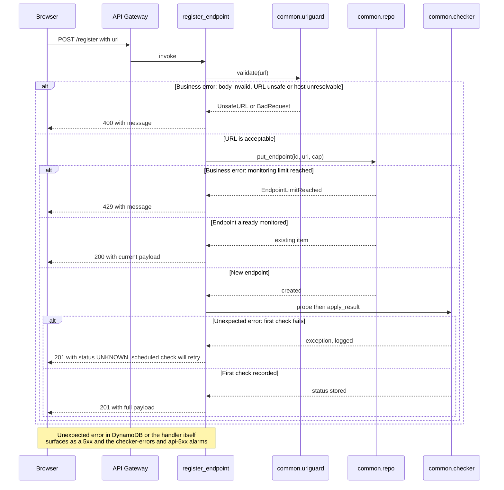
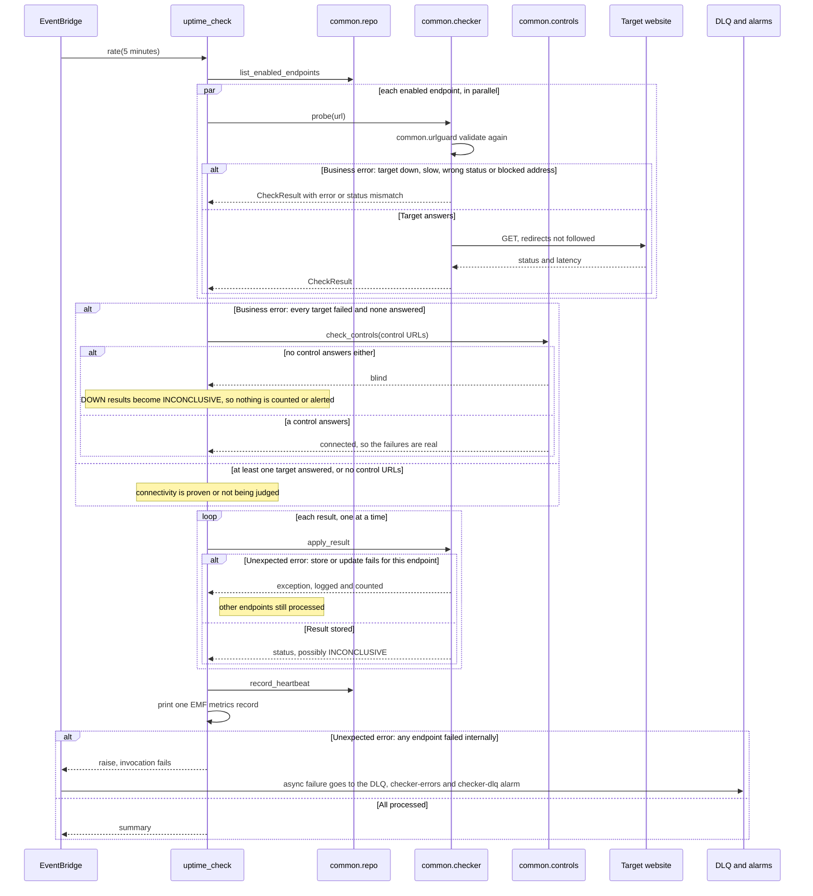
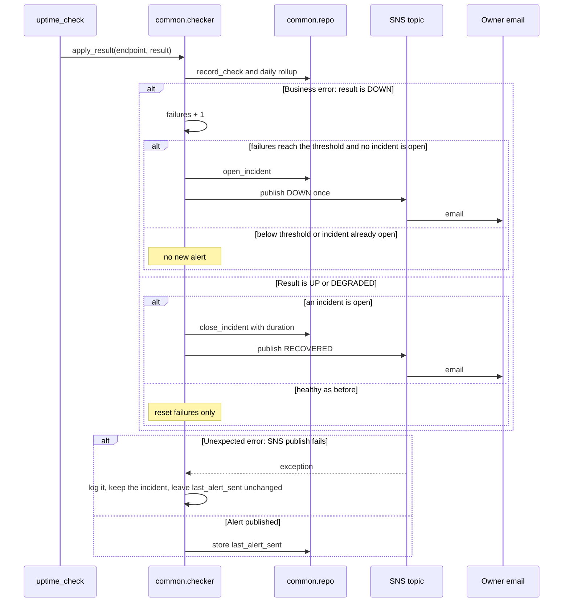
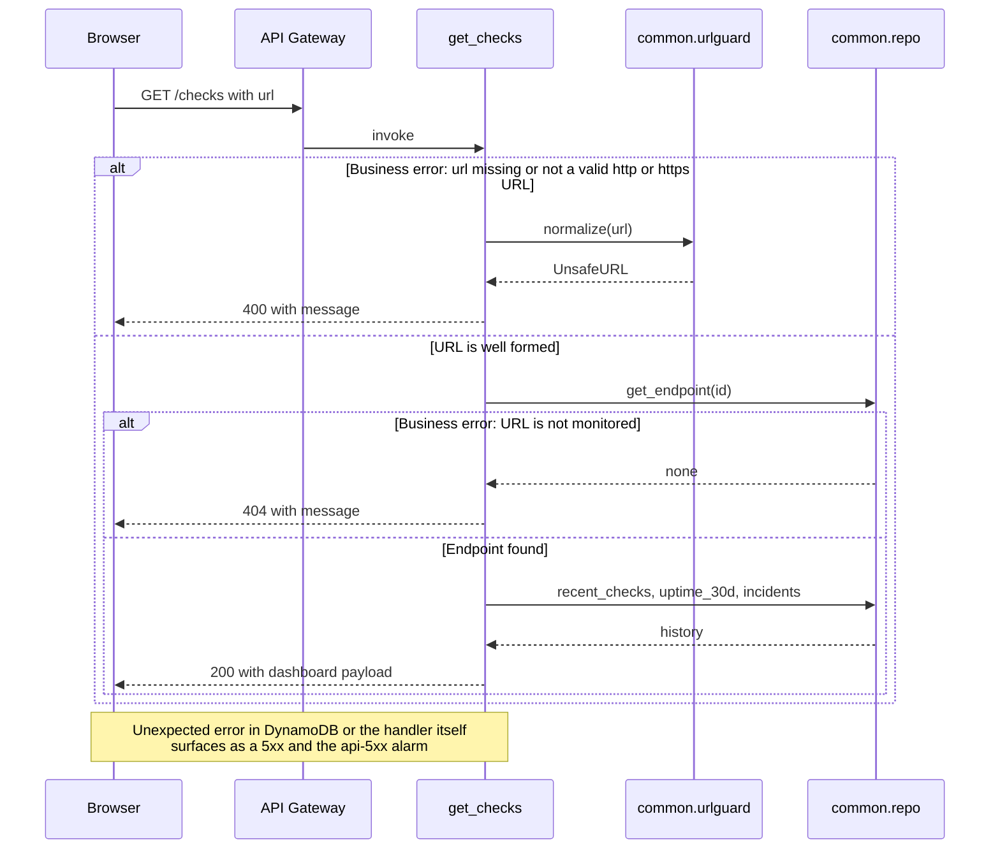

# Sequence diagrams

The four core flows, each with its failure paths. A **business error** is an expected outcome the caller
can act on (a 4xx response, an endpoint that is down). An **unexpected error** is VigilWatch itself failing
(a dependency error or a bug), which must be visible to the owner and must not corrupt other work.
Requirement IDs refer to [requirements.md](requirements.md). A test checks that every diagram has both
failure paths and names only modules that exist.

## Register a URL

Covers VW-001, VW-002 and VW-003.

## Scheduled check

Covers VW-004, VW-005, VW-006, VW-015 and VW-022.

## Alerting

Covers VW-009 and VW-010. The threshold defaults to 2 consecutive DOWN results.

## Read status

Covers VW-007, VW-008, VW-011 and VW-012.

